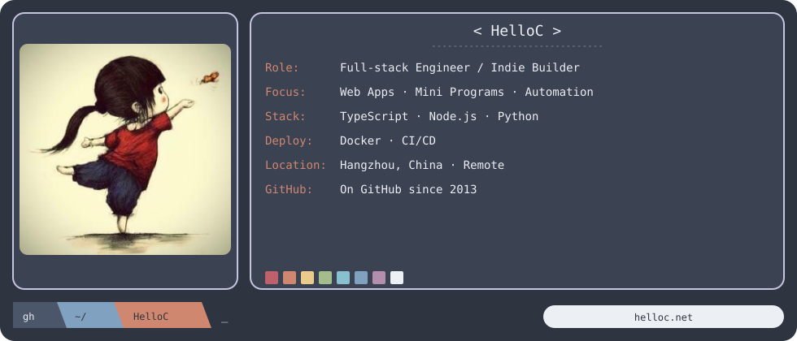

<h2 align="center">Hi, I'm HelloC 👋</h2>

<strong>Full-stack Engineer / Independent Builder</strong>

I build and maintain web apps, mini programs, and automation tools—from idea to production.

  <a href="https://helloc.net">Website</a> ·
  <a href="https://helloc.net/projects">Projects</a> ·
  <a href="https://helloc.net/contact">Contact</a>

### 📊 GitHub Snapshot

  
  

### 📬 Let’s build something useful

Open to freelance projects and remote collaboration.

**[Get in touch →](https://helloc.net/contact)**

A little progress every day. No effort goes to waste.

